# Klok kijken – de grote wijzer

## Klok kijken
background-info:
De grote wijzer (de lange wijzer) wijst naar een plek op de klok. Elke plek heeft een naam: 12 is "heel uur", 3 is "kwart over", 6 is "half" en 9 is "kwart voor".
question:
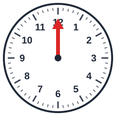 Waar wijst de grote wijzer naar?
- [ ] 10 over
- [x] heel uur
- [ ] half
- [ ] 5 voor half

## Klok kijken
background-info:
De grote wijzer (de lange wijzer) wijst naar een plek op de klok. Elke plek heeft een naam: 12 is "heel uur", 3 is "kwart over", 6 is "half" en 9 is "kwart voor".
question:
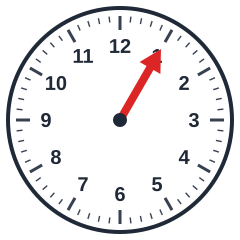 Waar wijst de grote wijzer naar?
- [x] 5 over
- [ ] 5 voor
- [ ] 5 over half
- [ ] 10 over half

## Klok kijken
background-info:
De grote wijzer (de lange wijzer) wijst naar een plek op de klok. Elke plek heeft een naam: 12 is "heel uur", 3 is "kwart over", 6 is "half" en 9 is "kwart voor".
question:
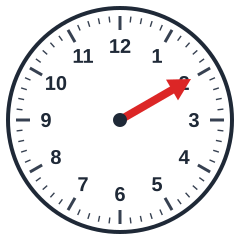 Waar wijst de grote wijzer naar?
- [ ] 10 voor
- [x] 10 over
- [ ] kwart voor
- [ ] 5 voor

## Klok kijken
background-info:
De grote wijzer (de lange wijzer) wijst naar een plek op de klok. Elke plek heeft een naam: 12 is "heel uur", 3 is "kwart over", 6 is "half" en 9 is "kwart voor".
question:
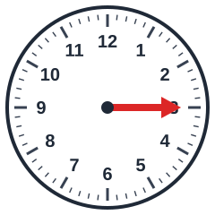 Waar wijst de grote wijzer naar?
- [x] kwart over
- [ ] 5 over
- [ ] half
- [ ] 10 voor

## Klok kijken
background-info:
De grote wijzer (de lange wijzer) wijst naar een plek op de klok. Elke plek heeft een naam: 12 is "heel uur", 3 is "kwart over", 6 is "half" en 9 is "kwart voor".
question:
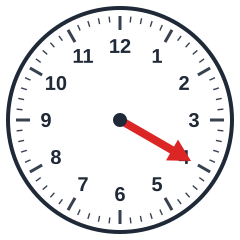 Waar wijst de grote wijzer naar?
- [ ] kwart voor
- [ ] 5 voor half
- [ ] 10 over
- [x] 10 voor half

## Klok kijken
background-info:
De grote wijzer (de lange wijzer) wijst naar een plek op de klok. Elke plek heeft een naam: 12 is "heel uur", 3 is "kwart over", 6 is "half" en 9 is "kwart voor".
question:
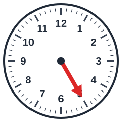 Waar wijst de grote wijzer naar?
- [ ] kwart over
- [ ] 5 over
- [x] 5 voor half
- [ ] 5 over half

## Klok kijken
background-info:
De grote wijzer (de lange wijzer) wijst naar een plek op de klok. Elke plek heeft een naam: 12 is "heel uur", 3 is "kwart over", 6 is "half" en 9 is "kwart voor".
question:
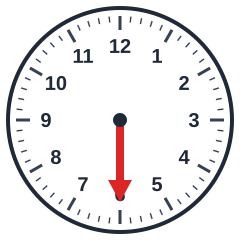 Waar wijst de grote wijzer naar?
- [ ] 5 voor
- [ ] kwart over
- [x] half
- [ ] 10 voor

## Klok kijken
background-info:
De grote wijzer (de lange wijzer) wijst naar een plek op de klok. Elke plek heeft een naam: 12 is "heel uur", 3 is "kwart over", 6 is "half" en 9 is "kwart voor".
question:
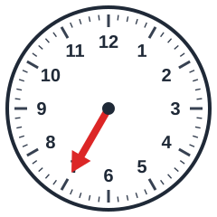 Waar wijst de grote wijzer naar?
- [ ] 5 voor half
- [x] 5 over half
- [ ] kwart voor
- [ ] heel uur

## Klok kijken
background-info:
De grote wijzer (de lange wijzer) wijst naar een plek op de klok. Elke plek heeft een naam: 12 is "heel uur", 3 is "kwart over", 6 is "half" en 9 is "kwart voor".
question:
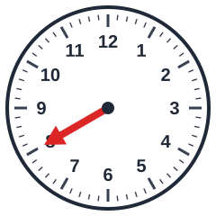 Waar wijst de grote wijzer naar?
- [ ] 5 over half
- [x] 10 over half
- [ ] 10 voor half
- [ ] 5 over

## Klok kijken
background-info:
De grote wijzer (de lange wijzer) wijst naar een plek op de klok. Elke plek heeft een naam: 12 is "heel uur", 3 is "kwart over", 6 is "half" en 9 is "kwart voor".
question:
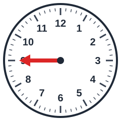 Waar wijst de grote wijzer naar?
- [x] kwart voor
- [ ] 10 over
- [ ] 10 voor
- [ ] half

## Klok kijken
background-info:
De grote wijzer (de lange wijzer) wijst naar een plek op de klok. Elke plek heeft een naam: 12 is "heel uur", 3 is "kwart over", 6 is "half" en 9 is "kwart voor".
question:
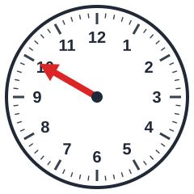 Waar wijst de grote wijzer naar?
- [ ] kwart voor
- [ ] 10 over
- [ ] 5 voor half
- [x] 10 voor

## Klok kijken
background-info:
De grote wijzer (de lange wijzer) wijst naar een plek op de klok. Elke plek heeft een naam: 12 is "heel uur", 3 is "kwart over", 6 is "half" en 9 is "kwart voor".
question:
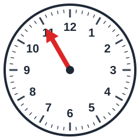 Waar wijst de grote wijzer naar?
- [x] 5 voor
- [ ] 10 over
- [ ] 10 voor
- [ ] heel uur
