# Klok kijken – hele uren

## Hele uren
background-info:
De lange wijzer (rood) staat op de 12. De korte wijzer (blauw) wijst naar het uur. Staat de korte wijzer op de 3? Dan is het 3 uur.
question:
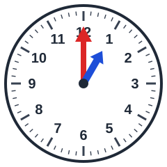 Hoe laat is het?
- [ ] 5 uur
- [ ] 8 uur
- [ ] 9 uur
- [x] 1 uur

## Hele uren
background-info:
De lange wijzer (rood) staat op de 12. De korte wijzer (blauw) wijst naar het uur. Staat de korte wijzer op de 3? Dan is het 3 uur.
question:
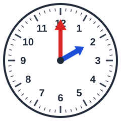 Hoe laat is het?
- [ ] 3 uur
- [x] 2 uur
- [ ] 1 uur
- [ ] 11 uur

## Hele uren
background-info:
De lange wijzer (rood) staat op de 12. De korte wijzer (blauw) wijst naar het uur. Staat de korte wijzer op de 3? Dan is het 3 uur.
question:
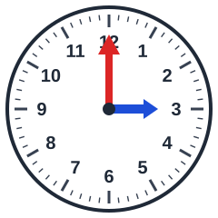 Hoe laat is het?
- [x] 3 uur
- [ ] 9 uur
- [ ] 11 uur
- [ ] 5 uur

## Hele uren
background-info:
De lange wijzer (rood) staat op de 12. De korte wijzer (blauw) wijst naar het uur. Staat de korte wijzer op de 3? Dan is het 3 uur.
question:
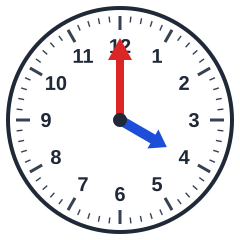 Hoe laat is het?
- [x] 4 uur
- [ ] 6 uur
- [ ] 5 uur
- [ ] 8 uur

## Hele uren
background-info:
De lange wijzer (rood) staat op de 12. De korte wijzer (blauw) wijst naar het uur. Staat de korte wijzer op de 3? Dan is het 3 uur.
question:
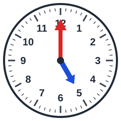 Hoe laat is het?
- [ ] 10 uur
- [x] 5 uur
- [ ] 6 uur
- [ ] 1 uur

## Hele uren
background-info:
De lange wijzer (rood) staat op de 12. De korte wijzer (blauw) wijst naar het uur. Staat de korte wijzer op de 3? Dan is het 3 uur.
question:
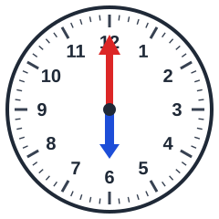 Hoe laat is het?
- [x] 6 uur
- [ ] 1 uur
- [ ] 8 uur
- [ ] 2 uur

## Hele uren
background-info:
De lange wijzer (rood) staat op de 12. De korte wijzer (blauw) wijst naar het uur. Staat de korte wijzer op de 3? Dan is het 3 uur.
question:
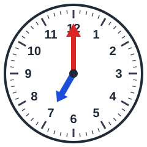 Hoe laat is het?
- [ ] 12 uur
- [ ] 9 uur
- [x] 7 uur
- [ ] 5 uur

## Hele uren
background-info:
De lange wijzer (rood) staat op de 12. De korte wijzer (blauw) wijst naar het uur. Staat de korte wijzer op de 3? Dan is het 3 uur.
question:
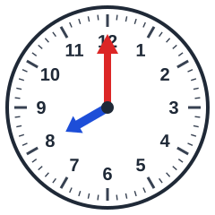 Hoe laat is het?
- [ ] 1 uur
- [ ] 5 uur
- [x] 8 uur
- [ ] 12 uur

## Hele uren
background-info:
De lange wijzer (rood) staat op de 12. De korte wijzer (blauw) wijst naar het uur. Staat de korte wijzer op de 3? Dan is het 3 uur.
question:
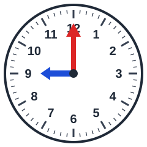 Hoe laat is het?
- [ ] 10 uur
- [ ] 12 uur
- [ ] 5 uur
- [x] 9 uur

## Hele uren
background-info:
De lange wijzer (rood) staat op de 12. De korte wijzer (blauw) wijst naar het uur. Staat de korte wijzer op de 3? Dan is het 3 uur.
question:
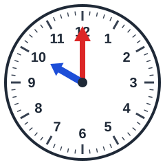 Hoe laat is het?
- [ ] 12 uur
- [ ] 3 uur
- [x] 10 uur
- [ ] 6 uur

## Hele uren
background-info:
De lange wijzer (rood) staat op de 12. De korte wijzer (blauw) wijst naar het uur. Staat de korte wijzer op de 3? Dan is het 3 uur.
question:
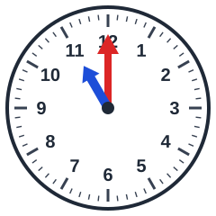 Hoe laat is het?
- [ ] 9 uur
- [x] 11 uur
- [ ] 3 uur
- [ ] 12 uur

## Hele uren
background-info:
De lange wijzer (rood) staat op de 12. De korte wijzer (blauw) wijst naar het uur. Staat de korte wijzer op de 3? Dan is het 3 uur.
question:
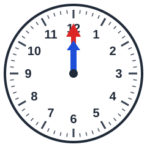 Hoe laat is het?
- [ ] 8 uur
- [x] 12 uur
- [ ] 7 uur
- [ ] 9 uur
