# Klok kijken – kwart over

## Klok kijken
background-info:
De lange wijzer (rood) en de korte wijzer (blauw) wijzen samen de tijd aan. De korte wijzer geeft het uur, de lange wijzer de minuten.
question:
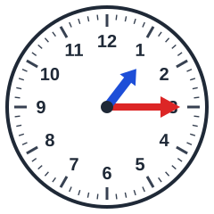 Hoe laat is het?
- [ ] kwart over 10
- [x] kwart over 1
- [ ] kwart over 4
- [ ] kwart over 6

## Klok kijken
background-info:
De lange wijzer (rood) en de korte wijzer (blauw) wijzen samen de tijd aan. De korte wijzer geeft het uur, de lange wijzer de minuten.
question:
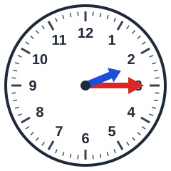 Hoe laat is het?
- [ ] kwart over 12
- [ ] kwart over 7
- [ ] kwart over 5
- [x] kwart over 2

## Klok kijken
background-info:
De lange wijzer (rood) en de korte wijzer (blauw) wijzen samen de tijd aan. De korte wijzer geeft het uur, de lange wijzer de minuten.
question:
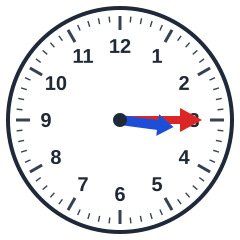 Hoe laat is het?
- [x] kwart over 3
- [ ] kwart over 2
- [ ] kwart over 10
- [ ] kwart over 7

## Klok kijken
background-info:
De lange wijzer (rood) en de korte wijzer (blauw) wijzen samen de tijd aan. De korte wijzer geeft het uur, de lange wijzer de minuten.
question:
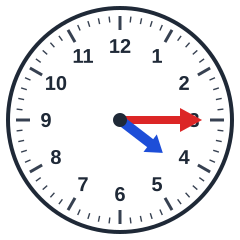 Hoe laat is het?
- [ ] kwart over 6
- [ ] kwart over 11
- [x] kwart over 4
- [ ] kwart over 10

## Klok kijken
background-info:
De lange wijzer (rood) en de korte wijzer (blauw) wijzen samen de tijd aan. De korte wijzer geeft het uur, de lange wijzer de minuten.
question:
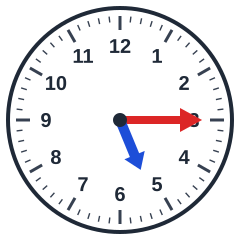 Hoe laat is het?
- [ ] kwart over 10
- [x] kwart over 5
- [ ] kwart over 2
- [ ] kwart over 7

## Klok kijken
background-info:
De lange wijzer (rood) en de korte wijzer (blauw) wijzen samen de tijd aan. De korte wijzer geeft het uur, de lange wijzer de minuten.
question:
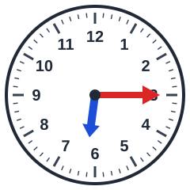 Hoe laat is het?
- [ ] kwart over 4
- [ ] kwart over 10
- [x] kwart over 6
- [ ] kwart over 8

## Klok kijken
background-info:
De lange wijzer (rood) en de korte wijzer (blauw) wijzen samen de tijd aan. De korte wijzer geeft het uur, de lange wijzer de minuten.
question:
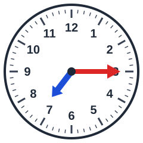 Hoe laat is het?
- [x] kwart over 7
- [ ] kwart over 9
- [ ] kwart over 11
- [ ] kwart over 1

## Klok kijken
background-info:
De lange wijzer (rood) en de korte wijzer (blauw) wijzen samen de tijd aan. De korte wijzer geeft het uur, de lange wijzer de minuten.
question:
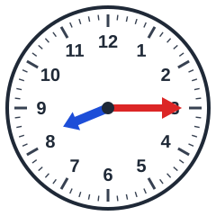 Hoe laat is het?
- [ ] kwart over 2
- [ ] kwart over 4
- [x] kwart over 8
- [ ] kwart over 3

## Klok kijken
background-info:
De lange wijzer (rood) en de korte wijzer (blauw) wijzen samen de tijd aan. De korte wijzer geeft het uur, de lange wijzer de minuten.
question:
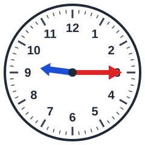 Hoe laat is het?
- [x] kwart over 9
- [ ] kwart over 12
- [ ] kwart over 10
- [ ] kwart over 4

## Klok kijken
background-info:
De lange wijzer (rood) en de korte wijzer (blauw) wijzen samen de tijd aan. De korte wijzer geeft het uur, de lange wijzer de minuten.
question:
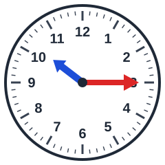 Hoe laat is het?
- [ ] kwart over 5
- [x] kwart over 10
- [ ] kwart over 1
- [ ] kwart over 6

## Klok kijken
background-info:
De lange wijzer (rood) en de korte wijzer (blauw) wijzen samen de tijd aan. De korte wijzer geeft het uur, de lange wijzer de minuten.
question:
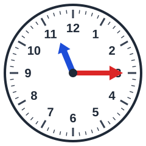 Hoe laat is het?
- [ ] kwart over 2
- [x] kwart over 11
- [ ] kwart over 4
- [ ] kwart over 7

## Klok kijken
background-info:
De lange wijzer (rood) en de korte wijzer (blauw) wijzen samen de tijd aan. De korte wijzer geeft het uur, de lange wijzer de minuten.
question:
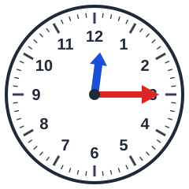 Hoe laat is het?
- [ ] kwart over 2
- [x] kwart over 12
- [ ] kwart over 7
- [ ] kwart over 4
