# Klok kijken – half

## Klok kijken
background-info:
De lange wijzer (rood) en de korte wijzer (blauw) wijzen samen de tijd aan. De korte wijzer geeft het uur, de lange wijzer de minuten.
question:
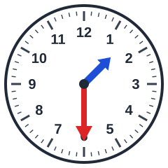 Hoe laat is het?
- [ ] half 5
- [ ] half 8
- [x] half 2
- [ ] half 10

## Klok kijken
background-info:
De lange wijzer (rood) en de korte wijzer (blauw) wijzen samen de tijd aan. De korte wijzer geeft het uur, de lange wijzer de minuten.
question:
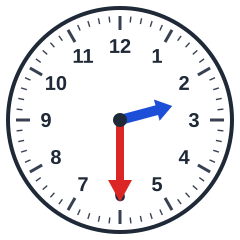 Hoe laat is het?
- [x] half 3
- [ ] half 7
- [ ] half 11
- [ ] half 9

## Klok kijken
background-info:
De lange wijzer (rood) en de korte wijzer (blauw) wijzen samen de tijd aan. De korte wijzer geeft het uur, de lange wijzer de minuten.
question:
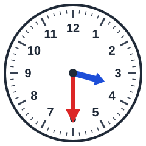 Hoe laat is het?
- [ ] half 9
- [x] half 4
- [ ] half 7
- [ ] half 8

## Klok kijken
background-info:
De lange wijzer (rood) en de korte wijzer (blauw) wijzen samen de tijd aan. De korte wijzer geeft het uur, de lange wijzer de minuten.
question:
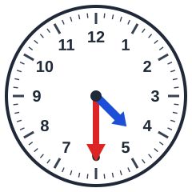 Hoe laat is het?
- [ ] half 2
- [ ] half 4
- [x] half 5
- [ ] half 10

## Klok kijken
background-info:
De lange wijzer (rood) en de korte wijzer (blauw) wijzen samen de tijd aan. De korte wijzer geeft het uur, de lange wijzer de minuten.
question:
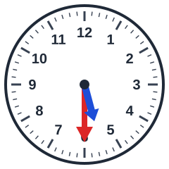 Hoe laat is het?
- [ ] half 8
- [ ] half 12
- [ ] half 10
- [x] half 6

## Klok kijken
background-info:
De lange wijzer (rood) en de korte wijzer (blauw) wijzen samen de tijd aan. De korte wijzer geeft het uur, de lange wijzer de minuten.
question:
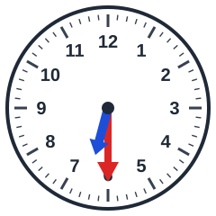 Hoe laat is het?
- [ ] half 8
- [ ] half 5
- [ ] half 12
- [x] half 7

## Klok kijken
background-info:
De lange wijzer (rood) en de korte wijzer (blauw) wijzen samen de tijd aan. De korte wijzer geeft het uur, de lange wijzer de minuten.
question:
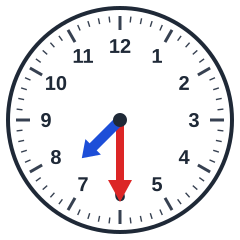 Hoe laat is het?
- [ ] half 5
- [ ] half 6
- [x] half 8
- [ ] half 11

## Klok kijken
background-info:
De lange wijzer (rood) en de korte wijzer (blauw) wijzen samen de tijd aan. De korte wijzer geeft het uur, de lange wijzer de minuten.
question:
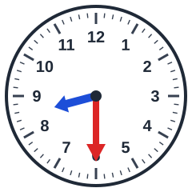 Hoe laat is het?
- [ ] half 8
- [ ] half 12
- [ ] half 10
- [x] half 9

## Klok kijken
background-info:
De lange wijzer (rood) en de korte wijzer (blauw) wijzen samen de tijd aan. De korte wijzer geeft het uur, de lange wijzer de minuten.
question:
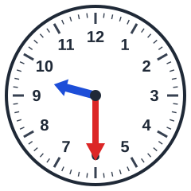 Hoe laat is het?
- [x] half 10
- [ ] half 9
- [ ] half 7
- [ ] half 11

## Klok kijken
background-info:
De lange wijzer (rood) en de korte wijzer (blauw) wijzen samen de tijd aan. De korte wijzer geeft het uur, de lange wijzer de minuten.
question:
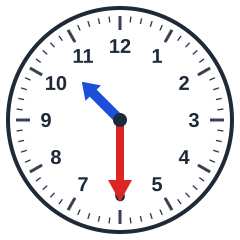 Hoe laat is het?
- [ ] half 5
- [ ] half 6
- [x] half 11
- [ ] half 7

## Klok kijken
background-info:
De lange wijzer (rood) en de korte wijzer (blauw) wijzen samen de tijd aan. De korte wijzer geeft het uur, de lange wijzer de minuten.
question:
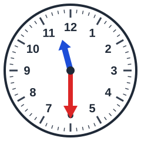 Hoe laat is het?
- [ ] half 6
- [x] half 12
- [ ] half 10
- [ ] half 8

## Klok kijken
background-info:
De lange wijzer (rood) en de korte wijzer (blauw) wijzen samen de tijd aan. De korte wijzer geeft het uur, de lange wijzer de minuten.
question:
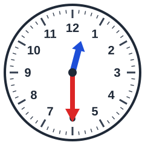 Hoe laat is het?
- [ ] half 6
- [ ] half 8
- [ ] half 4
- [x] half 1
