# Klok kijken – kwart voor

## Klok kijken
background-info:
De lange wijzer (rood) en de korte wijzer (blauw) wijzen samen de tijd aan. De korte wijzer geeft het uur, de lange wijzer de minuten.
question:
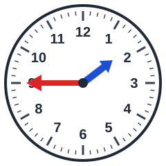 Hoe laat is het?
- [ ] kwart voor 8
- [ ] kwart voor 6
- [x] kwart voor 2
- [ ] kwart voor 5

## Klok kijken
background-info:
De lange wijzer (rood) en de korte wijzer (blauw) wijzen samen de tijd aan. De korte wijzer geeft het uur, de lange wijzer de minuten.
question:
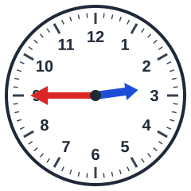 Hoe laat is het?
- [ ] kwart voor 5
- [ ] kwart voor 11
- [x] kwart voor 3
- [ ] kwart voor 4

## Klok kijken
background-info:
De lange wijzer (rood) en de korte wijzer (blauw) wijzen samen de tijd aan. De korte wijzer geeft het uur, de lange wijzer de minuten.
question:
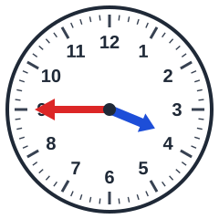 Hoe laat is het?
- [ ] kwart voor 6
- [ ] kwart voor 1
- [ ] kwart voor 8
- [x] kwart voor 4

## Klok kijken
background-info:
De lange wijzer (rood) en de korte wijzer (blauw) wijzen samen de tijd aan. De korte wijzer geeft het uur, de lange wijzer de minuten.
question:
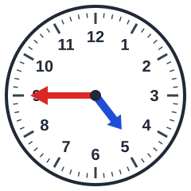 Hoe laat is het?
- [ ] kwart voor 3
- [x] kwart voor 5
- [ ] kwart voor 4
- [ ] kwart voor 8

## Klok kijken
background-info:
De lange wijzer (rood) en de korte wijzer (blauw) wijzen samen de tijd aan. De korte wijzer geeft het uur, de lange wijzer de minuten.
question:
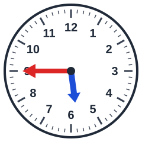 Hoe laat is het?
- [x] kwart voor 6
- [ ] kwart voor 8
- [ ] kwart voor 4
- [ ] kwart voor 11

## Klok kijken
background-info:
De lange wijzer (rood) en de korte wijzer (blauw) wijzen samen de tijd aan. De korte wijzer geeft het uur, de lange wijzer de minuten.
question:
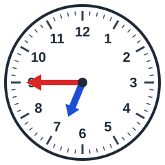 Hoe laat is het?
- [ ] kwart voor 8
- [ ] kwart voor 12
- [ ] kwart voor 5
- [x] kwart voor 7

## Klok kijken
background-info:
De lange wijzer (rood) en de korte wijzer (blauw) wijzen samen de tijd aan. De korte wijzer geeft het uur, de lange wijzer de minuten.
question:
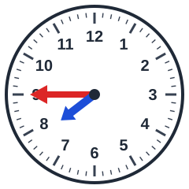 Hoe laat is het?
- [ ] kwart voor 12
- [ ] kwart voor 11
- [ ] kwart voor 1
- [x] kwart voor 8

## Klok kijken
background-info:
De lange wijzer (rood) en de korte wijzer (blauw) wijzen samen de tijd aan. De korte wijzer geeft het uur, de lange wijzer de minuten.
question:
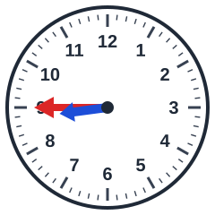 Hoe laat is het?
- [ ] kwart voor 2
- [x] kwart voor 9
- [ ] kwart voor 11
- [ ] kwart voor 10

## Klok kijken
background-info:
De lange wijzer (rood) en de korte wijzer (blauw) wijzen samen de tijd aan. De korte wijzer geeft het uur, de lange wijzer de minuten.
question:
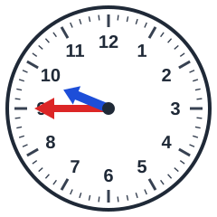 Hoe laat is het?
- [ ] kwart voor 6
- [x] kwart voor 10
- [ ] kwart voor 8
- [ ] kwart voor 5

## Klok kijken
background-info:
De lange wijzer (rood) en de korte wijzer (blauw) wijzen samen de tijd aan. De korte wijzer geeft het uur, de lange wijzer de minuten.
question:
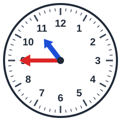 Hoe laat is het?
- [x] kwart voor 11
- [ ] kwart voor 1
- [ ] kwart voor 12
- [ ] kwart voor 9

## Klok kijken
background-info:
De lange wijzer (rood) en de korte wijzer (blauw) wijzen samen de tijd aan. De korte wijzer geeft het uur, de lange wijzer de minuten.
question:
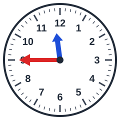 Hoe laat is het?
- [ ] kwart voor 11
- [ ] kwart voor 3
- [ ] kwart voor 6
- [x] kwart voor 12

## Klok kijken
background-info:
De lange wijzer (rood) en de korte wijzer (blauw) wijzen samen de tijd aan. De korte wijzer geeft het uur, de lange wijzer de minuten.
question:
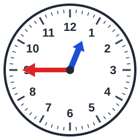 Hoe laat is het?
- [x] kwart voor 1
- [ ] kwart voor 12
- [ ] kwart voor 3
- [ ] kwart voor 10
