# Klok kijken – 5 over

## Klok kijken
background-info:
De lange wijzer (rood) en de korte wijzer (blauw) wijzen samen de tijd aan. De korte wijzer geeft het uur, de lange wijzer de minuten.
question:
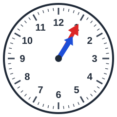 Hoe laat is het?
- [ ] 5 over 3
- [x] 5 over 1
- [ ] 5 over 12
- [ ] 5 over 10

## Klok kijken
background-info:
De lange wijzer (rood) en de korte wijzer (blauw) wijzen samen de tijd aan. De korte wijzer geeft het uur, de lange wijzer de minuten.
question:
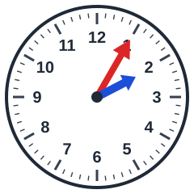 Hoe laat is het?
- [ ] 5 over 7
- [ ] 5 over 3
- [x] 5 over 2
- [ ] 5 over 8

## Klok kijken
background-info:
De lange wijzer (rood) en de korte wijzer (blauw) wijzen samen de tijd aan. De korte wijzer geeft het uur, de lange wijzer de minuten.
question:
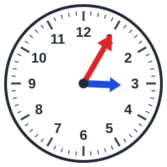 Hoe laat is het?
- [ ] 5 over 6
- [ ] 5 over 7
- [x] 5 over 3
- [ ] 5 over 9

## Klok kijken
background-info:
De lange wijzer (rood) en de korte wijzer (blauw) wijzen samen de tijd aan. De korte wijzer geeft het uur, de lange wijzer de minuten.
question:
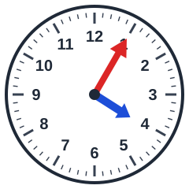 Hoe laat is het?
- [x] 5 over 4
- [ ] 5 over 7
- [ ] 5 over 5
- [ ] 5 over 12

## Klok kijken
background-info:
De lange wijzer (rood) en de korte wijzer (blauw) wijzen samen de tijd aan. De korte wijzer geeft het uur, de lange wijzer de minuten.
question:
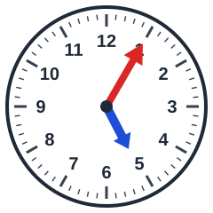 Hoe laat is het?
- [ ] 5 over 9
- [ ] 5 over 10
- [x] 5 over 5
- [ ] 5 over 8

## Klok kijken
background-info:
De lange wijzer (rood) en de korte wijzer (blauw) wijzen samen de tijd aan. De korte wijzer geeft het uur, de lange wijzer de minuten.
question:
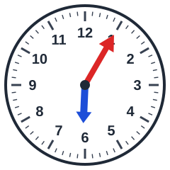 Hoe laat is het?
- [x] 5 over 6
- [ ] 5 over 9
- [ ] 5 over 7
- [ ] 5 over 10

## Klok kijken
background-info:
De lange wijzer (rood) en de korte wijzer (blauw) wijzen samen de tijd aan. De korte wijzer geeft het uur, de lange wijzer de minuten.
question:
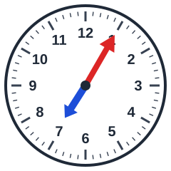 Hoe laat is het?
- [ ] 5 over 11
- [ ] 5 over 12
- [x] 5 over 7
- [ ] 5 over 3

## Klok kijken
background-info:
De lange wijzer (rood) en de korte wijzer (blauw) wijzen samen de tijd aan. De korte wijzer geeft het uur, de lange wijzer de minuten.
question:
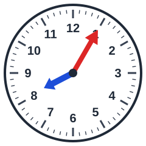 Hoe laat is het?
- [ ] 5 over 7
- [x] 5 over 8
- [ ] 5 over 12
- [ ] 5 over 9

## Klok kijken
background-info:
De lange wijzer (rood) en de korte wijzer (blauw) wijzen samen de tijd aan. De korte wijzer geeft het uur, de lange wijzer de minuten.
question:
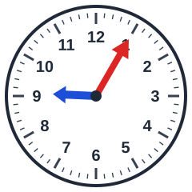 Hoe laat is het?
- [ ] 5 over 1
- [ ] 5 over 5
- [ ] 5 over 2
- [x] 5 over 9

## Klok kijken
background-info:
De lange wijzer (rood) en de korte wijzer (blauw) wijzen samen de tijd aan. De korte wijzer geeft het uur, de lange wijzer de minuten.
question:
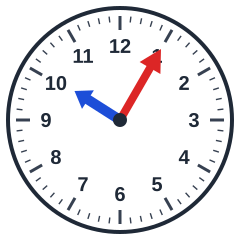 Hoe laat is het?
- [x] 5 over 10
- [ ] 5 over 8
- [ ] 5 over 6
- [ ] 5 over 2

## Klok kijken
background-info:
De lange wijzer (rood) en de korte wijzer (blauw) wijzen samen de tijd aan. De korte wijzer geeft het uur, de lange wijzer de minuten.
question:
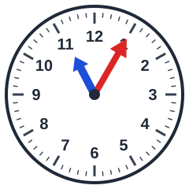 Hoe laat is het?
- [ ] 5 over 3
- [ ] 5 over 7
- [x] 5 over 11
- [ ] 5 over 6

## Klok kijken
background-info:
De lange wijzer (rood) en de korte wijzer (blauw) wijzen samen de tijd aan. De korte wijzer geeft het uur, de lange wijzer de minuten.
question:
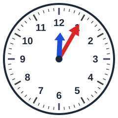 Hoe laat is het?
- [ ] 5 over 11
- [ ] 5 over 5
- [x] 5 over 12
- [ ] 5 over 3
