# Klok kijken – 10 voor half

## Klok kijken
background-info:
De lange wijzer (rood) en de korte wijzer (blauw) wijzen samen de tijd aan. De korte wijzer geeft het uur, de lange wijzer de minuten.
question:
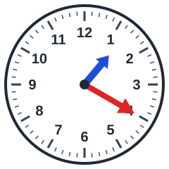 Hoe laat is het?
- [ ] 10 voor half 9
- [x] 10 voor half 2
- [ ] 10 voor half 11
- [ ] 10 voor half 1

## Klok kijken
background-info:
De lange wijzer (rood) en de korte wijzer (blauw) wijzen samen de tijd aan. De korte wijzer geeft het uur, de lange wijzer de minuten.
question:
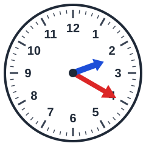 Hoe laat is het?
- [ ] 10 voor half 8
- [ ] 10 voor half 7
- [ ] 10 voor half 9
- [x] 10 voor half 3

## Klok kijken
background-info:
De lange wijzer (rood) en de korte wijzer (blauw) wijzen samen de tijd aan. De korte wijzer geeft het uur, de lange wijzer de minuten.
question:
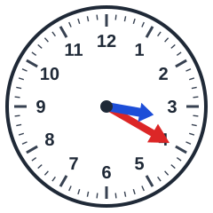 Hoe laat is het?
- [ ] 10 voor half 10
- [x] 10 voor half 4
- [ ] 10 voor half 8
- [ ] 10 voor half 12

## Klok kijken
background-info:
De lange wijzer (rood) en de korte wijzer (blauw) wijzen samen de tijd aan. De korte wijzer geeft het uur, de lange wijzer de minuten.
question:
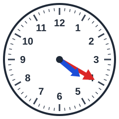 Hoe laat is het?
- [x] 10 voor half 5
- [ ] 10 voor half 2
- [ ] 10 voor half 1
- [ ] 10 voor half 10

## Klok kijken
background-info:
De lange wijzer (rood) en de korte wijzer (blauw) wijzen samen de tijd aan. De korte wijzer geeft het uur, de lange wijzer de minuten.
question:
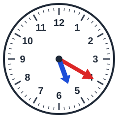 Hoe laat is het?
- [ ] 10 voor half 1
- [x] 10 voor half 6
- [ ] 10 voor half 7
- [ ] 10 voor half 10

## Klok kijken
background-info:
De lange wijzer (rood) en de korte wijzer (blauw) wijzen samen de tijd aan. De korte wijzer geeft het uur, de lange wijzer de minuten.
question:
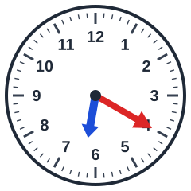 Hoe laat is het?
- [ ] 10 voor half 12
- [ ] 10 voor half 1
- [x] 10 voor half 7
- [ ] 10 voor half 8

## Klok kijken
background-info:
De lange wijzer (rood) en de korte wijzer (blauw) wijzen samen de tijd aan. De korte wijzer geeft het uur, de lange wijzer de minuten.
question:
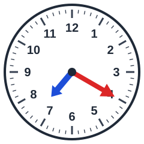 Hoe laat is het?
- [ ] 10 voor half 6
- [x] 10 voor half 8
- [ ] 10 voor half 5
- [ ] 10 voor half 1

## Klok kijken
background-info:
De lange wijzer (rood) en de korte wijzer (blauw) wijzen samen de tijd aan. De korte wijzer geeft het uur, de lange wijzer de minuten.
question:
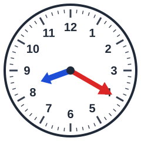 Hoe laat is het?
- [x] 10 voor half 9
- [ ] 10 voor half 1
- [ ] 10 voor half 11
- [ ] 10 voor half 4

## Klok kijken
background-info:
De lange wijzer (rood) en de korte wijzer (blauw) wijzen samen de tijd aan. De korte wijzer geeft het uur, de lange wijzer de minuten.
question:
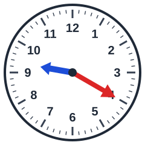 Hoe laat is het?
- [x] 10 voor half 10
- [ ] 10 voor half 3
- [ ] 10 voor half 8
- [ ] 10 voor half 11

## Klok kijken
background-info:
De lange wijzer (rood) en de korte wijzer (blauw) wijzen samen de tijd aan. De korte wijzer geeft het uur, de lange wijzer de minuten.
question:
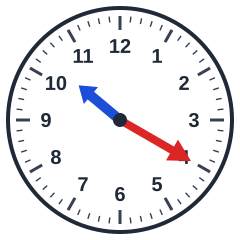 Hoe laat is het?
- [ ] 10 voor half 4
- [ ] 10 voor half 3
- [x] 10 voor half 11
- [ ] 10 voor half 8

## Klok kijken
background-info:
De lange wijzer (rood) en de korte wijzer (blauw) wijzen samen de tijd aan. De korte wijzer geeft het uur, de lange wijzer de minuten.
question:
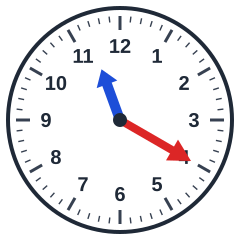 Hoe laat is het?
- [ ] 10 voor half 3
- [ ] 10 voor half 11
- [x] 10 voor half 12
- [ ] 10 voor half 7

## Klok kijken
background-info:
De lange wijzer (rood) en de korte wijzer (blauw) wijzen samen de tijd aan. De korte wijzer geeft het uur, de lange wijzer de minuten.
question:
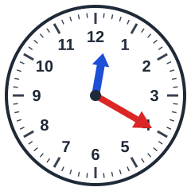 Hoe laat is het?
- [x] 10 voor half 1
- [ ] 10 voor half 5
- [ ] 10 voor half 12
- [ ] 10 voor half 7
