# Klok kijken – 5 over half

## Klok kijken
background-info:
De lange wijzer (rood) en de korte wijzer (blauw) wijzen samen de tijd aan. De korte wijzer geeft het uur, de lange wijzer de minuten.
question:
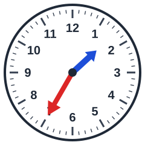 Hoe laat is het?
- [ ] 5 over half 5
- [x] 5 over half 2
- [ ] 5 over half 12
- [ ] 5 over half 6

## Klok kijken
background-info:
De lange wijzer (rood) en de korte wijzer (blauw) wijzen samen de tijd aan. De korte wijzer geeft het uur, de lange wijzer de minuten.
question:
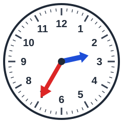 Hoe laat is het?
- [ ] 5 over half 5
- [ ] 5 over half 11
- [ ] 5 over half 10
- [x] 5 over half 3

## Klok kijken
background-info:
De lange wijzer (rood) en de korte wijzer (blauw) wijzen samen de tijd aan. De korte wijzer geeft het uur, de lange wijzer de minuten.
question:
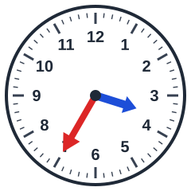 Hoe laat is het?
- [x] 5 over half 4
- [ ] 5 over half 2
- [ ] 5 over half 10
- [ ] 5 over half 9

## Klok kijken
background-info:
De lange wijzer (rood) en de korte wijzer (blauw) wijzen samen de tijd aan. De korte wijzer geeft het uur, de lange wijzer de minuten.
question:
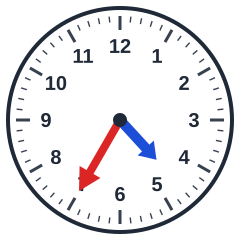 Hoe laat is het?
- [ ] 5 over half 6
- [ ] 5 over half 7
- [x] 5 over half 5
- [ ] 5 over half 12

## Klok kijken
background-info:
De lange wijzer (rood) en de korte wijzer (blauw) wijzen samen de tijd aan. De korte wijzer geeft het uur, de lange wijzer de minuten.
question:
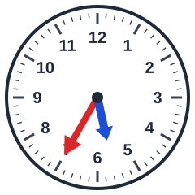 Hoe laat is het?
- [ ] 5 over half 11
- [x] 5 over half 6
- [ ] 5 over half 4
- [ ] 5 over half 3

## Klok kijken
background-info:
De lange wijzer (rood) en de korte wijzer (blauw) wijzen samen de tijd aan. De korte wijzer geeft het uur, de lange wijzer de minuten.
question:
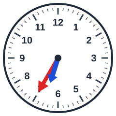 Hoe laat is het?
- [ ] 5 over half 6
- [ ] 5 over half 3
- [ ] 5 over half 11
- [x] 5 over half 7

## Klok kijken
background-info:
De lange wijzer (rood) en de korte wijzer (blauw) wijzen samen de tijd aan. De korte wijzer geeft het uur, de lange wijzer de minuten.
question:
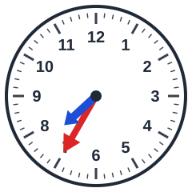 Hoe laat is het?
- [ ] 5 over half 7
- [ ] 5 over half 9
- [x] 5 over half 8
- [ ] 5 over half 3

## Klok kijken
background-info:
De lange wijzer (rood) en de korte wijzer (blauw) wijzen samen de tijd aan. De korte wijzer geeft het uur, de lange wijzer de minuten.
question:
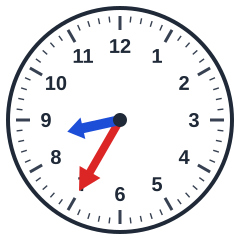 Hoe laat is het?
- [ ] 5 over half 6
- [x] 5 over half 9
- [ ] 5 over half 8
- [ ] 5 over half 2

## Klok kijken
background-info:
De lange wijzer (rood) en de korte wijzer (blauw) wijzen samen de tijd aan. De korte wijzer geeft het uur, de lange wijzer de minuten.
question:
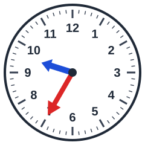 Hoe laat is het?
- [ ] 5 over half 1
- [ ] 5 over half 8
- [ ] 5 over half 2
- [x] 5 over half 10

## Klok kijken
background-info:
De lange wijzer (rood) en de korte wijzer (blauw) wijzen samen de tijd aan. De korte wijzer geeft het uur, de lange wijzer de minuten.
question:
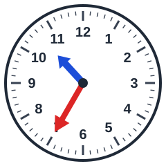 Hoe laat is het?
- [ ] 5 over half 12
- [ ] 5 over half 7
- [ ] 5 over half 1
- [x] 5 over half 11

## Klok kijken
background-info:
De lange wijzer (rood) en de korte wijzer (blauw) wijzen samen de tijd aan. De korte wijzer geeft het uur, de lange wijzer de minuten.
question:
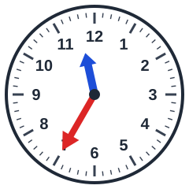 Hoe laat is het?
- [ ] 5 over half 3
- [ ] 5 over half 9
- [x] 5 over half 12
- [ ] 5 over half 2

## Klok kijken
background-info:
De lange wijzer (rood) en de korte wijzer (blauw) wijzen samen de tijd aan. De korte wijzer geeft het uur, de lange wijzer de minuten.
question:
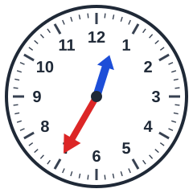 Hoe laat is het?
- [ ] 5 over half 9
- [ ] 5 over half 6
- [x] 5 over half 1
- [ ] 5 over half 7
