# Klok kijken – 5 voor

## Klok kijken
background-info:
De lange wijzer (rood) en de korte wijzer (blauw) wijzen samen de tijd aan. De korte wijzer geeft het uur, de lange wijzer de minuten.
question:
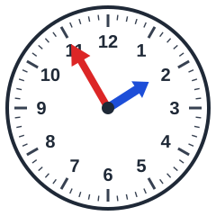 Hoe laat is het?
- [x] 5 voor 2
- [ ] 5 voor 6
- [ ] 5 voor 7
- [ ] 5 voor 8

## Klok kijken
background-info:
De lange wijzer (rood) en de korte wijzer (blauw) wijzen samen de tijd aan. De korte wijzer geeft het uur, de lange wijzer de minuten.
question:
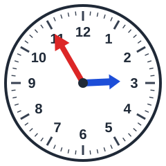 Hoe laat is het?
- [ ] 5 voor 12
- [x] 5 voor 3
- [ ] 5 voor 6
- [ ] 5 voor 7

## Klok kijken
background-info:
De lange wijzer (rood) en de korte wijzer (blauw) wijzen samen de tijd aan. De korte wijzer geeft het uur, de lange wijzer de minuten.
question:
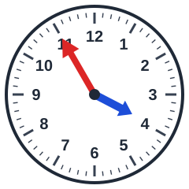 Hoe laat is het?
- [x] 5 voor 4
- [ ] 5 voor 8
- [ ] 5 voor 1
- [ ] 5 voor 11

## Klok kijken
background-info:
De lange wijzer (rood) en de korte wijzer (blauw) wijzen samen de tijd aan. De korte wijzer geeft het uur, de lange wijzer de minuten.
question:
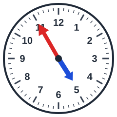 Hoe laat is het?
- [ ] 5 voor 11
- [ ] 5 voor 2
- [ ] 5 voor 7
- [x] 5 voor 5

## Klok kijken
background-info:
De lange wijzer (rood) en de korte wijzer (blauw) wijzen samen de tijd aan. De korte wijzer geeft het uur, de lange wijzer de minuten.
question:
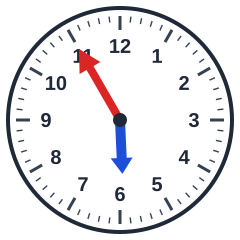 Hoe laat is het?
- [x] 5 voor 6
- [ ] 5 voor 7
- [ ] 5 voor 9
- [ ] 5 voor 5

## Klok kijken
background-info:
De lange wijzer (rood) en de korte wijzer (blauw) wijzen samen de tijd aan. De korte wijzer geeft het uur, de lange wijzer de minuten.
question:
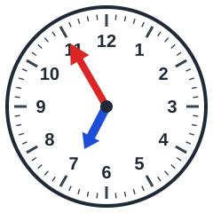 Hoe laat is het?
- [x] 5 voor 7
- [ ] 5 voor 10
- [ ] 5 voor 1
- [ ] 5 voor 4

## Klok kijken
background-info:
De lange wijzer (rood) en de korte wijzer (blauw) wijzen samen de tijd aan. De korte wijzer geeft het uur, de lange wijzer de minuten.
question:
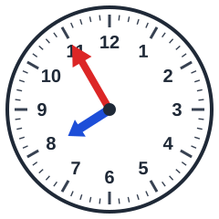 Hoe laat is het?
- [x] 5 voor 8
- [ ] 5 voor 7
- [ ] 5 voor 11
- [ ] 5 voor 6

## Klok kijken
background-info:
De lange wijzer (rood) en de korte wijzer (blauw) wijzen samen de tijd aan. De korte wijzer geeft het uur, de lange wijzer de minuten.
question:
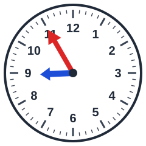 Hoe laat is het?
- [x] 5 voor 9
- [ ] 5 voor 8
- [ ] 5 voor 7
- [ ] 5 voor 6

## Klok kijken
background-info:
De lange wijzer (rood) en de korte wijzer (blauw) wijzen samen de tijd aan. De korte wijzer geeft het uur, de lange wijzer de minuten.
question:
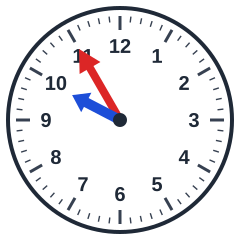 Hoe laat is het?
- [ ] 5 voor 9
- [x] 5 voor 10
- [ ] 5 voor 1
- [ ] 5 voor 12

## Klok kijken
background-info:
De lange wijzer (rood) en de korte wijzer (blauw) wijzen samen de tijd aan. De korte wijzer geeft het uur, de lange wijzer de minuten.
question:
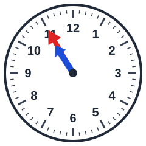 Hoe laat is het?
- [ ] 5 voor 6
- [ ] 5 voor 8
- [x] 5 voor 11
- [ ] 5 voor 9

## Klok kijken
background-info:
De lange wijzer (rood) en de korte wijzer (blauw) wijzen samen de tijd aan. De korte wijzer geeft het uur, de lange wijzer de minuten.
question:
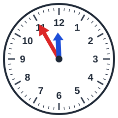 Hoe laat is het?
- [ ] 5 voor 1
- [ ] 5 voor 5
- [ ] 5 voor 9
- [x] 5 voor 12

## Klok kijken
background-info:
De lange wijzer (rood) en de korte wijzer (blauw) wijzen samen de tijd aan. De korte wijzer geeft het uur, de lange wijzer de minuten.
question:
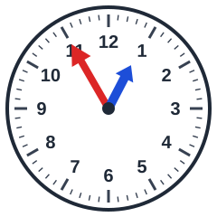 Hoe laat is het?
- [x] 5 voor 1
- [ ] 5 voor 5
- [ ] 5 voor 8
- [ ] 5 voor 4
